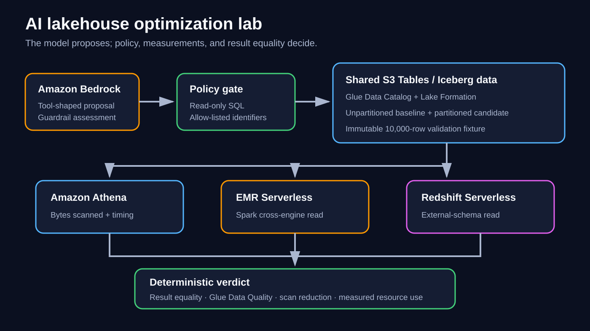
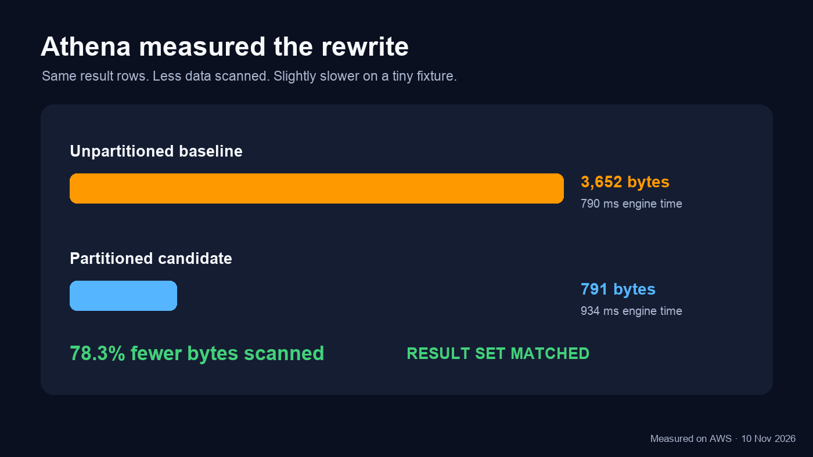
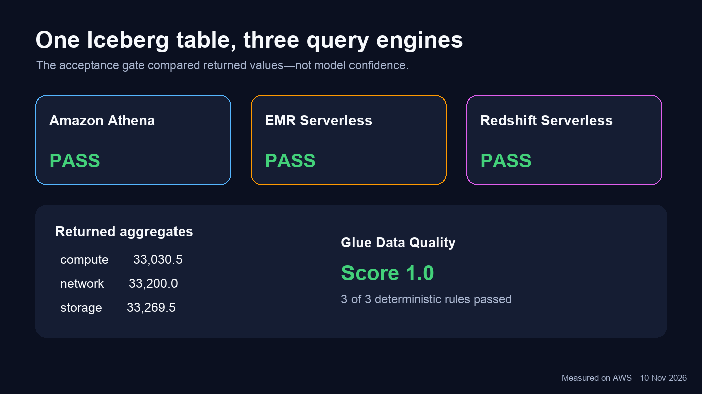
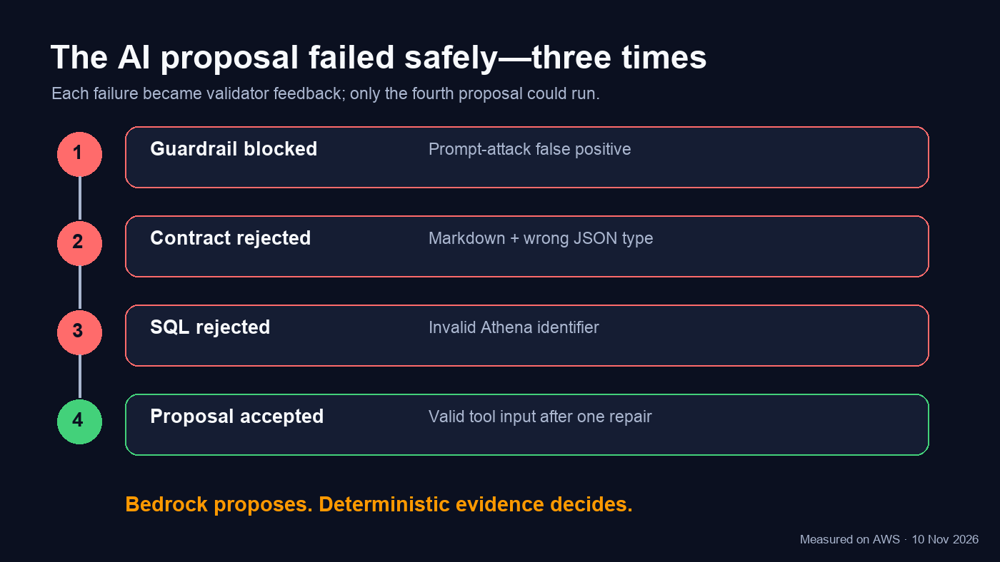

# AI Lakehouse Query Lab

This project tests a deliberately stricter question than “can an LLM write
SQL?”:

> Can an AI recommend a cheaper analytical query or execution engine, and can
> deterministic evidence prove that the recommendation is safe and useful?

The lab uses Amazon Bedrock for proposals and Amazon Athena, Amazon EMR
Serverless, Amazon Redshift Serverless, Amazon S3 Tables, AWS Glue, and AWS
Lake Formation for controlled validation. AI output never receives authority
to execute directly. A policy gate, result comparison, data-quality checks,
and measured execution statistics decide whether a proposal is accepted.



## Safety model

- Only read-only `SELECT` or `WITH ... SELECT` candidates are accepted.
- Catalog, namespace, tables, and columns are allow-listed.
- Original and candidate queries run against the same immutable test data.
- Result hashes and row counts must match.
- A recommendation must beat a configured savings threshold.
- Every created AWS resource is tagged and recorded for deterministic cleanup.

## What the run measured

On a disposable 10,000-row fixture, the partitioned Athena candidate returned
the same aggregates while scanning 791 bytes instead of 3,652 bytes: a 78.3%
reduction. It was slightly slower on this tiny fixture, so the evidence
supports a scan-efficiency claim—not a runtime or cost-savings claim.

Athena, EMR Serverless, and Redshift Serverless returned the same values.
Glue Data Quality scored the fixture 1.0 with all three deterministic rules
passing.







## Run locally

```bash
python3 -m unittest discover -s tests -v
```

The evidence renderer additionally requires Pillow:

```bash
python3 scripts/render_evidence.py
```

See:

- `verification.md` for measured results and cleanup status
- `DEPLOYMENT.md` for the reproducible deployment and validation sequence
- `evidence/validation-summary.json` for sanitized machine-readable evidence
- `infra/bedrock-request.json` for the parameterized tool-use contract

The disposable AWS resources from the documented run were removed and their
absence was verified.

